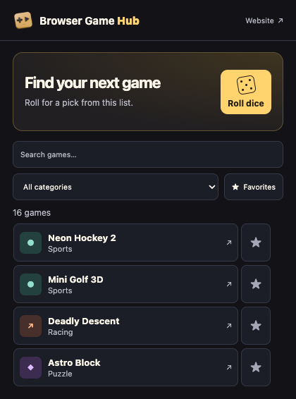
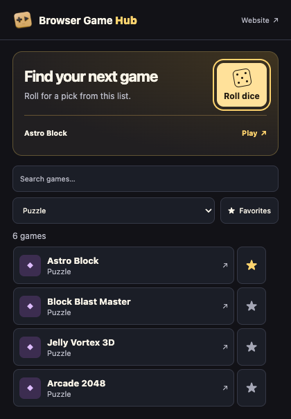

# Browser Game Hub – Game Finder

**English** · [简体中文](README.zh-CN.md)

Find free browser games from the Chrome toolbar. Search the catalog, save your favorites, or roll the dice to pick what to play next.

[Website][website] · [Download ZIP][releases] · [Report an issue][issues] · [Buy us a coffee][coffee]

## Screenshots

| Find and save games | Roll the dice |
| --- | --- |
|  |  |

## What it does

- Search by title or filter racing, puzzle, sports, and arcade games inside the popup.
- Star games to keep a favorites list in your browser.
- Roll the dice to pick a game from the current results. Select **Play** to open its page on Browser Game Hub.

The extension requests no browser permissions. Finding, filtering, and saving games work locally. Game pages open on the website when you select a link. [Privacy details](PRIVACY.md)

## Install from GitHub

1. Download and unzip the [latest release][releases].
2. Open `chrome://extensions` and turn on **Developer mode**.
3. Select **Load unpacked** and choose the extracted folder containing `manifest.json`.
4. Open Browser Game Hub from Chrome's Extensions menu. Pin it to keep the dice one click away.

For development, load the `extension/` directory directly. Run `npm run check` to test catalog behavior and package rules. Run `npm run package` on macOS or Linux to create the distribution ZIP in `dist/`.

The extension source uses the [MIT License](LICENSE). Browser Game Hub branding and online games are subject to their own rights and terms.

[website]: https://browsergamehub.net/?utm_source=github&utm_medium=referral&utm_campaign=browser-games-extension-readme
[releases]: https://github.com/TideSparrow/browser-games-extension/releases/latest
[issues]: https://github.com/TideSparrow/browser-games-extension/issues
[coffee]: https://buymeacoffee.com/marklongpcm
