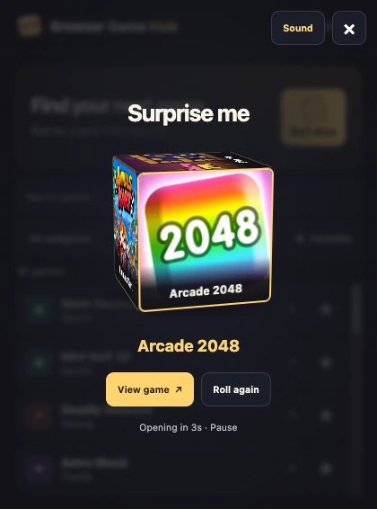

# Browser Game Hub – Game Finder

**English** · [简体中文](README.zh-CN.md)

Find free browser games from the Chrome, Edge, Brave, or Firefox toolbar. Search the catalog, save your favorites, or roll the dice to pick what to play next.

[Website][website] · [Download ZIP][releases] · [Report an issue][issues] · [Buy us a coffee][coffee]

## Screenshots

| Find and save games | Roll the dice |
| --- | --- |
|  |  |

## What it does

- Search the full Browser Game Hub catalog by title, aliases, or tags and filter by category.
- Star games to keep a favorites list in your browser.
- The popup follows your browser language. Use the language menu in the toolbar popup to choose from 12 languages. Unsupported browser languages fall back to English.
- Roll the 3D dice to pick from the current results. The game opens after three seconds. You can pause the countdown, open the game immediately, or roll again.

The extension requests no browser permissions. It refreshes the public game catalog as needed and keeps a local copy for offline search. [Privacy details](PRIVACY.md)

## Install from GitHub

### Chrome, Edge, and Brave

All three browsers use the same [`browser-games-extension.zip`][chromium-zip]. Chrome users can also install it from the [Chrome Web Store][chrome-store].

| Browser | Extensions page |
| --- | --- |
| Chrome | `chrome://extensions` |
| Edge | `edge://extensions` |
| Brave | `brave://extensions` |

1. Download and extract the ZIP.
2. Open your browser's extensions page and turn on **Developer mode**.
3. Click **Load unpacked** and select the folder that contains `manifest.json`.
4. Open Browser Game Hub from the Extensions menu.

### Firefox

1. Download [`browser-games-extension-firefox.zip`][firefox-zip].
2. In desktop Firefox 142 or later, open `about:debugging#/runtime/this-firefox`.
3. Click **Load Temporary Add-on** and select the ZIP directly.

Firefox removes the temporary add-on when it restarts. Permanent installation requires Mozilla signing.

For Chromium development, load the `extension/` directory directly. Run `npm run check` to test catalog behavior and package rules. Run `npm run package` on macOS or Linux to build both ZIPs in `dist/`.

The extension source uses the [MIT License](LICENSE). Browser Game Hub branding and online games are subject to their own rights and terms.

[website]: https://browsergamehub.net/?utm_source=github&utm_medium=referral&utm_campaign=browser-games-extension-readme
[releases]: https://github.com/TideSparrow/browser-games-extension/releases/latest
[chromium-zip]: https://github.com/TideSparrow/browser-games-extension/releases/latest/download/browser-games-extension.zip
[firefox-zip]: https://github.com/TideSparrow/browser-games-extension/releases/latest/download/browser-games-extension-firefox.zip
[chrome-store]: https://chromewebstore.google.com/detail/bgmhfpfhhefjickkagdbopbngbgiojeb
[issues]: https://github.com/TideSparrow/browser-games-extension/issues
[coffee]: https://buymeacoffee.com/marklongpcm
