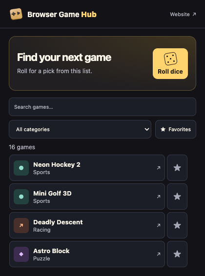

# Browser Game Hub 游戏查找器

[English](README.md) · **简体中文**

在 Chrome 工具栏里查找免费浏览器游戏。可以搜索、收藏喜欢的游戏，也可以掷骰子，让它帮你选一个。

[官网][website] · [下载 ZIP][releases] · [反馈问题][issues] · [请我们喝杯咖啡][coffee]

## 运行截图

| 查找和收藏游戏 | 掷骰子选游戏 |
| --- | --- |
|  |  |

## 主要功能

- 在弹窗里按名称搜索，或筛选赛车、益智、体育和街机游戏。
- 点击星标，把喜欢的游戏保存在当前浏览器中。
- 掷 3D 骰子从当前结果里随机选一款游戏，三秒后打开对应页面。你也可以暂停倒计时、立即查看游戏或再抽一次。

插件不申请浏览器权限。查找、筛选和收藏在本地完成。 [隐私说明](PRIVACY.md)

## 从 GitHub 安装

1. 下载并解压 [最新版本][releases]。
2. 打开 `chrome://extensions`，开启「开发者模式」。
3. 选择「加载已解压的扩展程序」，选中包含 `manifest.json` 的解压目录。
4. 在 Chrome 的扩展程序菜单里打开 Browser Game Hub，也可以把它固定到工具栏。

开发时可以直接加载仓库中的 `extension/` 目录。运行 `npm run check` 检查游戏目录和打包规则。在 macOS 或 Linux 上运行 `npm run package`，ZIP 会生成在 `dist/`。

插件源码采用 [MIT 许可证](LICENSE)。Browser Game Hub 品牌和在线游戏遵循各自的权利及许可条款。

[website]: https://browsergamehub.net/?utm_source=github&utm_medium=referral&utm_campaign=browser-games-extension-readme
[releases]: https://github.com/TideSparrow/browser-games-extension/releases/latest
[issues]: https://github.com/TideSparrow/browser-games-extension/issues
[coffee]: https://buymeacoffee.com/marklongpcm
